# “潭合同”台账管理系统 —— 用户操作手册

> 适用系统：**“潭合同”台账管理系统**
> 使用单位：**湘潭市机关事务管理局**
> 版本：V1.5（2026年10月）
> 修订说明：V1.1 校正提醒规则、数据范围、备份规则等说明；新增“日志审计”菜单、删除原因填写、日志保留天数与附件大小限制设置等说明；新增首页“待支付项目数”“待支付总金额”卡片与“待支付提醒”区域（含更多/折叠）、合同“打印为PDF”功能、合同台账“资金来源”字段（录入/查询/导出/模板/打印同步支持）等说明。 V1.2 数据库完整性规范化治理（枚举标准化、部门修复、日期规范化）；导入模板必填校验与友好提示；系统升级自动执行数据库版本迁移（无需人工干预）等说明。 **V1.3 新增“资产合同”菜单与“资产合同台账”操作页面（含归档、附件、导入导出、查询统计）；首页统计卡片与提醒列表改版（三张卡片支持悬停查看构成占比、资产合同并入到期提醒）；“合同台账”菜单改名“项目合同”、编辑弹窗标题改为“编辑项目合同”；查询统计改为“项目合同查询统计 / 资产合同查询统计”选项卡；“日志审计”新增“字段级变更日志”区域；统计与提醒按部门范围过滤的统一说明。 V1.4 资产合同“租金收取明细”改造为动态明细表（新增/编辑/删除、应缴/实缴/差额实时汇总、缴款方式枚举下拉且默认“直缴非税”、归档只读）；资产列表取消“缴款方式”列；合同级“缴款方式”字段取消；编辑弹窗改版（押金上移、取消“租金信息”区、责任人与提醒提前天数移至“管理部门”行）并新增“资产现状图片”附件；首页新增“待收/支合同数”“待收/支总金额”卡片与“待收/支提醒”列表（五张卡片悬停热区扩大至数字与单位）；“已缴租金合计”改为按租金明细实缴金额自动汇总；“年租/年租合计”统一改称“年租金/年租金合计”；字段级变更日志新增租金明细变更记录；两个合同编辑弹窗位置与宽度统一。**
> **V1.5 修订说明（2026年10月）**：新增“短信提醒”功能——到期提醒、待收提醒、待支提醒可自动/手动向经办人、现场负责人、责任人、承租人发送短信（默认每周一 09:00 自动提醒、每人一条）；新增左侧菜单“短信记录”（发送记录查询、点对点发送、失败重发）、“编辑项目/资产合同”弹窗内的“短信提醒”按钮（模板催办 / 点对点发送 / 单合同短信开关），以及“系统设置”中的“短信提醒设置”“短信模板”；新增资产合同“打印为PDF”；部门名称显示简化（如“湘潭市机关事务管理局本级-办公室”显示为“局本级-办公室”、其余单位省略“湘潭市机关事务管理局”前缀）；本手册同步更新全部界面截图。
> **V1.5.1 修订说明（2026年10月11日）**：按《政务短信平台使用注意事项》落实发送合规——① 短信内容**禁止出现「【】」**（会被判多签名阻断），签名改由平台按应用签名自动添加，系统不再拼接中括号签名；② 新增**敏感词拦截**（词表可维护）；③ 内容超长按「单段字数」**自动分段发送**；④ 发送前校验**号码必须是有效手机号**；⑤ 同一号码**每日最多 100 条**；⑥ 同一号码**最小发送间隔**限制。系统设置新增“内容与频率限制（平台规范）”一组配置；本手册新增 **10.7 平台使用规范与发送限制**与 FAQ 的 Q25~Q27。
> **V1.5.2 修订说明（2026年10月12日）**：发送短信时在**每条短信正文末尾自动追加机构署名「（湘潭市机关事务管理局）」**（使用全角括号，符合平台“内容不得含【】”的规范）；署名文本与开关位于“系统设置 → 内容与频率限制（平台规范）”（新增“署名文本”输入框，可清空以取消署名）。数据库迁移至 **v29**；同时**移除设置页中已废弃的「短信签名」输入框**（迁移 v30 删除对应配置项 `sms_sign_name`，其作用已由“署名文本”取代）。
> **V1.8 修订说明（2026年10月12日）**：① **合同编号改为系统自动生成**——新增项目合同/资产合同时，系统按《合同编号规则》自动生成 **6 位编号**（年度后两位 + 科室（中心）序号 + 中心组室序号 + 2 位顺序号），弹窗中的编号栏**只读、不可手工修改**；资产合同编号随“管理部门”自动重新生成；历史合同编号一律保持不变（详见 **4.11 合同编号规则** 与 FAQ Q28~Q30）。② **用户数据按通讯录批量导入**——新增用户并补齐联系电话，用户列表按“单位 → 科室（中心）→ 通讯录序号”重排；导入后用户由 29 人增至 **54 人**、部门由 15 个增至 **22 个**（详见 **7.6 用户数据批量导入（通讯录）**）。③ **数据库内部调整**——项目合同附件表由 `attachments` 改名为 `project_attachments`，仅数据库层改名，**附件上传/下载/删除与接口路径完全不变，对使用者无影响**。
> **V1.8.4 修订说明（2026年10月13日）**：① **金额单位标注统一** —— 项目合同「新增 / 编辑」弹窗中，**决策的招标控制价（万元）**、**结算金额（万元）**、**已支付（万元）**、**未支付（万元）** 四个字段已标注单位（与既有的“合同金额（万元）”一致），填写时请统一按**万元**录入；② **编号不可修改（服务端同步加固）** —— 除弹窗内编号栏只读外，接口层也会拒绝改号（提示“合同编号由《合同编号规则》自动生成，不允许修改”），编号一经生成不可自行修改；③ **字段校验与提示更明确** —— 保存时日期须为 `yyyy-mm-dd`（如输入 `2026/1/9` 会自动规范为 `2026-01-09`；像 `2026-13-40` 这类不存在的日期会被拒绝并提示具体字段）、金额必须为数字且不小于 0、项目分类/采购方式/资金来源/是否结算/是否有签证或变更必须选择标准取值，非法时**保存失败并给出中文原因**；④ **资产现状图片仅支持图片格式** —— 在上传区选择 PDF 会被拒绝（决策依据附件、合同附件仍支持图片与 PDF）；⑤ **数据调整** —— 编号 `266301~266314` 共 10 条项目合同的“所属部门”已由**后勤中心-物业组**调整为**后勤中心-工程组**，这些合同在“按部门”的可见范围与统计归属上从属于工程组（经办人杨惠风原属工程组，调整后仍可正常查看与编辑）。本手册对应章节已同步更新，详见 **4.4 新增合同**、**4.5 编辑项目合同**、**5.7 附件管理** 与 FAQ **Q31、Q32**。
> **V1.8.5 修订说明（2026年10月13日）**：新增/补齐四项通用能力——① **会话空闲超时**：长时间不操作（默认 **30 分钟**，可在"系统设置"调整）会自动退出登录，保护账号安全（见 **1.1 登录注意事项**、**8.5 会话空闲超时**）；② **附件在线预览**：项目/资产合同的附件列表中新增「**预览**」按钮，图片直接显示、PDF 内嵌阅读，无需下载（见 **4.8**、**5.7**）；③ **密码与登录策略**：新增账号或被重置密码后**首次登录必须先改密码**，新密码须 **≥8 位且不能为纯数字/纯字母、不能与用户名相同、不能是 123456**；连续 **5 次**输错密码将**锁定 15 分钟**（见 **7.7 修改本人密码**、**7.4 重置密码**、FAQ Q33）；④ **导入校验结果导出**：批量导入后如存在错误行，可点击「**导出校验结果**」下载带「校验结果 / 问题说明」两列的 Excel，修改后直接重新导入（见 **4.1 顶部工具栏**、FAQ Q35）。
> 截图说明：手册内截图取自系统实际界面，随版本迭代可能与最新界面略有差异，功能说明以正文文字为准。

---

## 目录

- 一、登录系统
- 二、主界面布局介绍
- 三、首页、合同到期提醒与待收/支提醒
- 四、项目合同台账管理
- 五、资产合同台账管理
- 六、查询统计
- 七、用户管理（仅管理员）
- 八、系统设置（仅管理员）
- 九、日志审计
- 十、短信提醒（含发送记录与短信设置）
- 十一、退出系统
- 附录A：到期提醒与颜色说明
- 附录B：数据备份与恢复规则
- 附录C：常见问题（FAQ）

---

## 一、登录系统

系统部署后，通过浏览器（推荐 Chrome、Edge）访问：

```
http://localhost:5000
```

打开后显示系统登录界面，界面为蓝色科技风全屏渐变背景，中央为半透明登录卡片，从上到下依次为：LOGO 图片、系统名称“潭合同-台账管理系统”、使用单位“湘潭市机关事务管理局”、用户名与密码输入框、登录按钮。

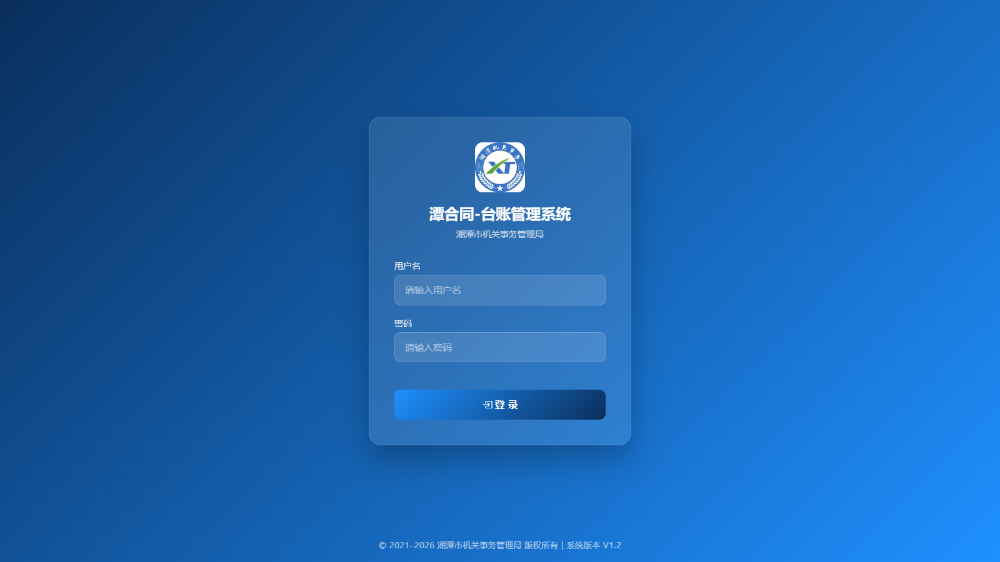

**操作步骤：**

1. 打开浏览器，输入系统地址 `http://localhost:5000`，回车进入登录页。
2. 在“用户名”输入框中输入您的登录账号（工号或拼音，如 `admin`）。
3. 在“密码”输入框中输入您的密码（如初始密码 `123456`）。
4. 点击蓝色“登 录”按钮。
5. 登录成功后自动进入系统主界面；如账号或密码错误，页面会提示错误信息，请重新输入。

> 提示：初始管理员账号为 `admin`，密码为 `123456`。**首次登录后请尽快自行修改密码**（右上角「修改密码」）。

**1.1 登录注意事项：**

1. **密码规则**：修改密码时，新密码须**至少 8 位**，且不能是纯数字、不能是纯字母、不能与用户名相同，也不能使用 `123456` 这类初始/弱口令。
2. **首次登录强制改密**：管理员**新建的账号**（初始密码 `123456`）或**被重置过密码**的账号，首次登录时会弹出「请先修改密码」对话框，**必须修改密码后才能使用其它功能**。
3. **登录失败锁定**：连续 **5 次**输入错误密码，账号将被**锁定 15 分钟**（提示"密码错误次数过多，账号已锁定 15 分钟"），锁定期内即使输入正确密码也无法登录，请稍后再试或联系管理员。
4. **长时间未操作自动退出**：登录后若连续**无任何操作**超过设定的空闲时长（默认 **30 分钟**，管理员可在"系统设置 → 会话空闲超时"调整），系统会自动退出登录并提示"长时间未操作，已自动退出，请重新登录"。

---

## 二、主界面布局介绍

登录成功后进入系统主界面，整体分为三个区域：

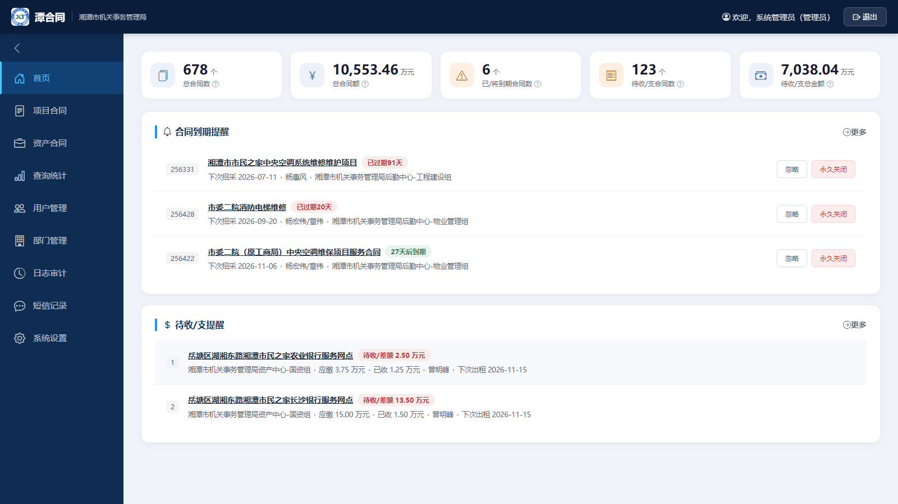

**1. 顶部导航栏（深蓝色）**
- 左侧：单位 LOGO、系统名称“潭合同”、使用单位“湘潭市机关事务管理局”。
- 右侧：显示“欢迎，XXX（角色）”，以及“退出”按钮。

**2. 左侧菜单栏（深蓝灰色，宽 220px）**
- **首页**：统计概览与“合同到期提醒”“待收/支提醒”两个列表。
- **项目合同**：项目合同的查询、新增、编辑、删除、归档、附件、导出、导入等日常维护操作（菜单原名为“合同台账”）。
- **资产合同**：资产合同的查询、新增、编辑、删除、归档、附件、导出、导入等日常维护操作（V1.3 新增）。
- **查询统计**：按部门、经办人、项目分类、时间等维度进行统计分析与图表展示；页面内以“项目合同查询统计 / 资产合同查询统计”选项卡切换。
- **用户管理**：仅管理员可见，维护用户与部门信息。
- **部门管理**：仅管理员可见（也可在“用户管理”页内打开），维护部门组合。
- **日志审计**：操作日志（审计）与字段级变更日志的查询、筛选与导出（管理员可查看全部日志，普通用户仅查看本人日志）。
- **系统设置**：仅管理员可见，设置全局默认提醒天数、日志保留天数、全局默认上传最大附件。

**3. 主内容区（浅灰蓝色背景）**
- 显示当前菜单对应的功能页面，白色卡片、圆角阴影，整体风格统一为蓝色科技风。

点击左侧菜单项即可切换页面，当前所在页面会在菜单中高亮显示。

---

## 三、首页、合同到期提醒与待收/支提醒

首页顶部展示五张统计卡片，下方依次为“合同到期提醒”与“待收/支提醒”两个列表区域。


### 3.1 五张统计卡片

| 卡片名称 | 含义 |
|----------|------|
| 总合同数（个） | 项目合同数与资产合同数之和（当前用户可见范围）。 |
| 总合同额（万元） | 项目合同金额合计 + 资产合同“总合同额”合计（资产合同按元录入，展示时统一折算为万元，保留两位小数）。 |
| 已/将到期合同数（个） | 项目合同“下次招采时间”提醒 + 资产合同“下次出租时间”提醒合并后的条数。 |
| **待收/支合同数（个）** | **待收合同数 + 待支合同数**。待收＝资产合同下租金“Σ应缴金额 − Σ实缴金额 > 0”的合同数；待支＝当前可见范围内“未归档且未支付金额大于 0”的项目合同数。 |
| **待收/支总金额（万元）** | **待收金额 + 待支金额**（单位：万元）。待收＝资产合同下租金差额合计（含多缴的负数差额，元→万元，保留两位小数）；待支＝项目合同待支付金额合计。 |

**悬停查看构成**

- **五张卡片**（总合同数、总合同额、已/将到期合同数、待收/支合同数、待收/支总金额）都带问号图标；在**卡片数字、数字后的单位或标题文字**上悬停即弹出提示气泡，鼠标移开即消失。
- 气泡内为环形图＋一行构成说明，占比由系统按当前数据实时计算（基数为两部分之和），例如：
  - 总合同数：`项目合同 500 个（占 78%），资产合同 139 个（占 22%）`；
  - 已/将到期合同数：`项目合同 3 个（占 50%），资产合同 3 个（占 50%）`；
  - 待收/支合同数：`待收合同数 5 个（占 6%），待支合同数 84 个（占 94%）`；
  - 待收/支总金额：`待收金额 26.00 万元（占 0%），待支金额 6837.41 万元（占 100%）`。

> 说明：
> - 管理员可见全部合同；普通用户与查询用户仅统计本部门及分管部门范围内的数据。
> - 项目合同按“所属部门”匹配可见范围；**资产合同按“管理部门”匹配**（两者规则对称）。
> - **待支侧（项目合同）金额取值**：优先取合同台账“未支付”字段（包括 0）；若该字段为空，则按“合同金额 − 已支付”计算（合同金额、已支付为空时按 0 处理）。
> - **待支项目判定**：合同未归档（归档状态为“否”或空）且待支付金额大于 0。
> - **待收侧（资产合同）口径**：按资产合同汇总其“租金收取明细”的“应缴金额（元） − 实缴金额（元）”；差额大于 0 的合同计入“待收合同数”，差额合计计入“待收金额”（多缴形成的负数差额按原值参与合计）。
> - “待收/支”卡片与“待收/支提醒”**同时涵盖项目合同（待支）与资产合同（待收）**，两者分别按各自口径计算后相加。

### 3.2 合同到期提醒列表

当存在符合条件的到期提醒合同时，首页“合同到期提醒”区域会显示提醒列表。**项目合同与资产合同的提醒合并在同一列表**，按“剩余天数”升序排列（最紧急的排在最前面），每条按“左—中—右”三栏展示：

- **左栏（编号）**：合同编号（项目合同为合同编号，资产合同为记录序号），浅灰底色小标签。
- **中栏（核心信息）**：第一行为项目名称/资产名称（单击可跳转到对应的“编辑项目合同”或“编辑资产合同”弹窗，鼠标悬停显示完整名称）；紧随状态胶囊（如“已过期 40 天”为浅红胶囊、“10 天后到期”为浅黄胶囊、“30 天后到期”为浅绿胶囊）。第二行为元数据，用圆点“·”分隔：下次招采时间（资产合同显示“下次出租”）· 经办人（资产合同显示责任人）· 所属部门/管理部门。
- **右栏（操作）**：“忽略”为灰色描边幽灵按钮，“永久关闭”为浅红底红字按钮。

- **“忽略”按钮**：点击后该条提醒在当前登录期间不再显示（仅本次登录有效，下次登录仍会提示）。
- **“永久关闭”按钮**：点击后弹出二次确认框，确认后清空提醒触发时间——项目合同清空“下次招采时间”，资产合同清空“下次出租时间”，该条不再产生提醒。
- **已归档合同**：提醒条目标记“已归档”，仅可“忽略”，不可“永久关闭”（归档合同为只读）。
- **更多/折叠**：提醒条数超过 3 条时，默认仅显示前 3 条，区域标题右侧显示“更多”链接；点击“更多”展开全部提醒，链接变为“折叠”；点击“折叠”恢复仅显示前 3 条。提醒条数不超过 3 条时全部显示且不显示该链接（风格与“待收/支提醒”一致）。
- **超长文本**：项目名称过长时单行省略号显示，鼠标悬停显示完整名称提示；鼠标悬停整行时背景变为极浅蓝色，提示该行可操作。

若当前没有符合条件的到期合同，页面显示“暂无到期合同”的空状态提示。

### 3.3 提醒规则（重要）

**项目合同**：同时满足以下条件的合同进入提醒列表

1. “下次招采时间”不为空；
2. 当前日期 ≥（下次招采时间 − 提醒提前天数）；
3. 合同属于当前用户可见范围（按“所属部门”＝本部门 + 分管部门）。

**资产合同**：同时满足以下条件的资产合同进入同一提醒列表

1. “下次出租时间”不为空（编辑资产合同时默认取“租期结束日 + 1 天”，可手工修改）；
2. 当前日期 ≥（下次出租时间 − 提醒提前天数）；
3. 资产合同属于当前用户可见范围（按“管理部门”＝本部门 + 分管部门）。

> 说明：所有合同与资产合同（含已归档记录）只要满足上述条件均参与到期提醒。如需停止某条提醒，可在提醒列表点击“永久关闭”（项目合同清空“下次招采时间”，资产合同清空“下次出租时间”）。

其中“提醒提前天数”优先取合同/资产合同自身的“提醒提前天数”字段；若为空，则使用系统设置中的全局默认值（默认 60 天）。

### 3.4 待收/支提醒

“**待收/支提醒**”区域位于“合同到期提醒”下方，标题带美元图标（V1.4 起由“待支付提醒”更名，原“待支付项目共 X 个”统计说明已取消）。

- **列表构成**：先显示**待收**项（资产合同租金未收齐，来自“租金收取明细”），再显示**待支**项（项目合同待支付）；各自判定如下：
  - 待收：该资产合同 `Σ应缴金额（元） − Σ实缴金额（元） > 0`（按收款期次汇总后为正）；
  - 待支：合同未归档（归档状态为“否”或空）且待支付金额大于 0（优先取“未支付”字段，为空则按“合同金额 − 已支付”）。
- **徽章与明细行**：
  - 待收项徽章为“**待收/差额 X 万元**”，明细行为：管理部门 · 应缴 X 万元 · 已收 X 万元 · 责任人 · 下次出租日期；点击资产名称打开“编辑资产合同”弹窗（可在其中登记收款明细）。
  - 待支项徽章为“**待支/差额 X 万元**”，明细行为：所属部门 · 结算 X 万元 · 已支付 X 万元 · 经办人 · 采购时间；点击项目名称打开“编辑项目合同”弹窗。
- **更多 / 折叠**：符合条件记录大于 2 条时，默认仅显示前 2 条，并在标题右侧显示“更多”链接；点击“更多”展开全部记录，链接文字变为“折叠”；点击“折叠”恢复为仅显示前 2 条。
- **数据范围**：管理员查看全部；普通用户与查询用户仅查看本部门及分管部门范围内的合同（项目按“所属部门”、资产按“管理部门”）。
- **空状态**：无符合条件记录时显示“恭喜，暂无待收/支合同”。

---

## 四、项目合同台账管理

点击左侧菜单“项目合同”，进入项目合同列表页面（页面标题为“项目合同台账”），可进行查询、新增、编辑、删除、归档、导出、导入等操作。

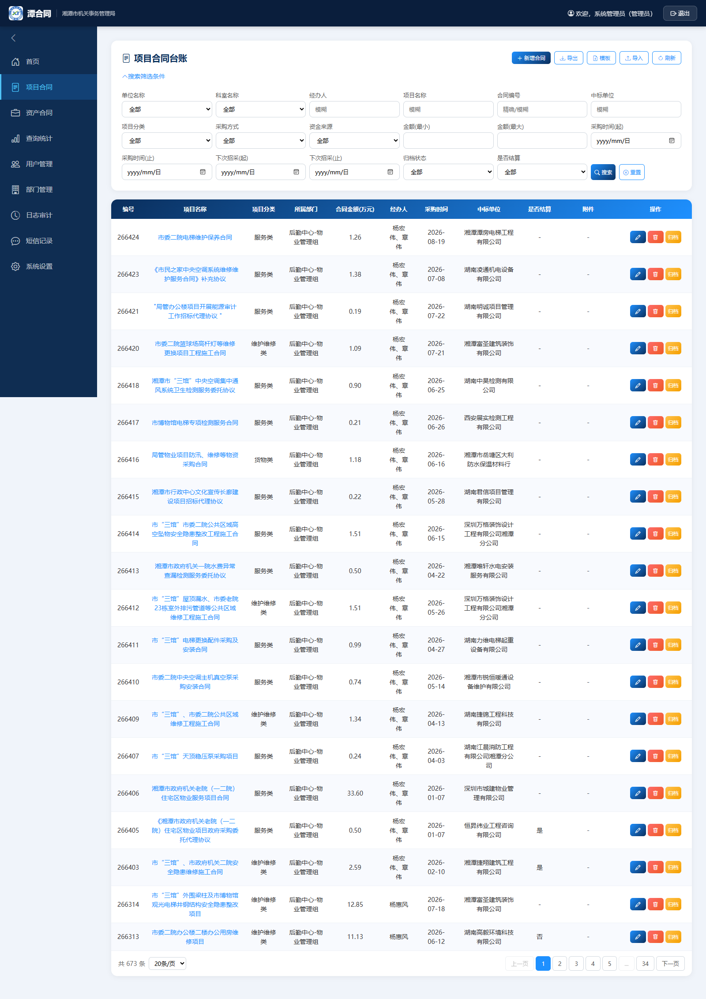

### 4.1 顶部工具栏

- **新增合同**：弹出新增合同表单。
- **导出**：将当前查询结果导出为 Excel 文件（.xlsx）。
- **模板 / 导入**：管理员可下载标准导入模板，并按“导入预览 → 确认导入”的流程批量导入数据。
  - 导入模板共 **29 列**，其中 **9 个必填列**：编号、项目分类、项目名称、采购方式、合同金额（万元）、资金来源、合同主要内容、经办人、所属部门（模板“填写说明”第 2 条已注明）。
  - 导入前建议先使用“导入预览”，系统会逐行校验：必填非空、编号唯一、枚举值在标准选项内、日期格式 `yyyy-mm-dd`、金额为数字、所属部门存在于部门列表；错误行（必填为空、编号重复、枚举/日期/金额不合规）会被标记且**不会导入**。
  - 若提交后数据库仍拒绝写入，系统会给出中文原因提示（如必填为空、编号重复、金额非负、日期格式错误等），请按提示检查对应行后重新导入。
- **刷新**：重新加载最新数据。
- **导出校验结果**（管理员）：选择待校验的 Excel 文件后，系统按"导入预览"的同一套规则逐行校验，并导出一个 Excel —— **保留原表头**，末尾追加「**校验结果**」（通过 / 警告 / 错误）与「**问题说明**」两列（含全部行）。填报人可**直接在导出的文件上修改**不合格行，改好后**原样重新导入**即可，无需人工抄录错误清单。资产合同列表的工具栏中同样提供该按钮。

### 4.2 查询与筛选

点击“搜索”区域可展开/折叠筛选条件，支持以下组合条件：

- 单位名称（下拉）、科室名称（下拉）
- 经办人、项目名称、合同编号、中标单位（模糊查询）
- 项目分类（服务类/维护维修类/货物类/建设项目）
- 采购方式（公开招标/竞争性磋商/竞争性谈判/自行采购）
- 资金来源（年初部门预算/年中追加预算/统筹预算/上级专项转移支付/上年结转结余/其他）
- 合同金额区间、采购时间范围、下次招采时间范围
- 是否结算（是/否）、归档状态（已归档/未归档）

设置条件后点击“搜索”按钮执行查询，点击“重置”清空条件。

### 4.3 表格与分页

- 表格列：编号、项目名称、项目分类、所属部门、合同金额（万元）、经办人、采购时间、中标单位、是否结算、附件、操作（编辑/删除/归档）。
- 表头深蓝色、斑马纹、鼠标悬停行高亮。
- 列表默认按**合同编号降序**排列（数字编号从大到小；非数字编号排在最后），搜索筛选后仍保持该顺序。
- 每页可切换 **20 条 / 50 条**，底部显示总条数与页码，可翻页查看。

### 4.4 新增合同

点击“新增合同”按钮弹出表单（与编辑共用一个模态框），弹窗标题为“**新增项目合同**”（编辑时为“编辑项目合同”），包含合同台账全部 29 个字段。 9 个必填字段（含资金来源）为红色星号标注，未填无法保存；资金来源固定为 6 个下拉选项。

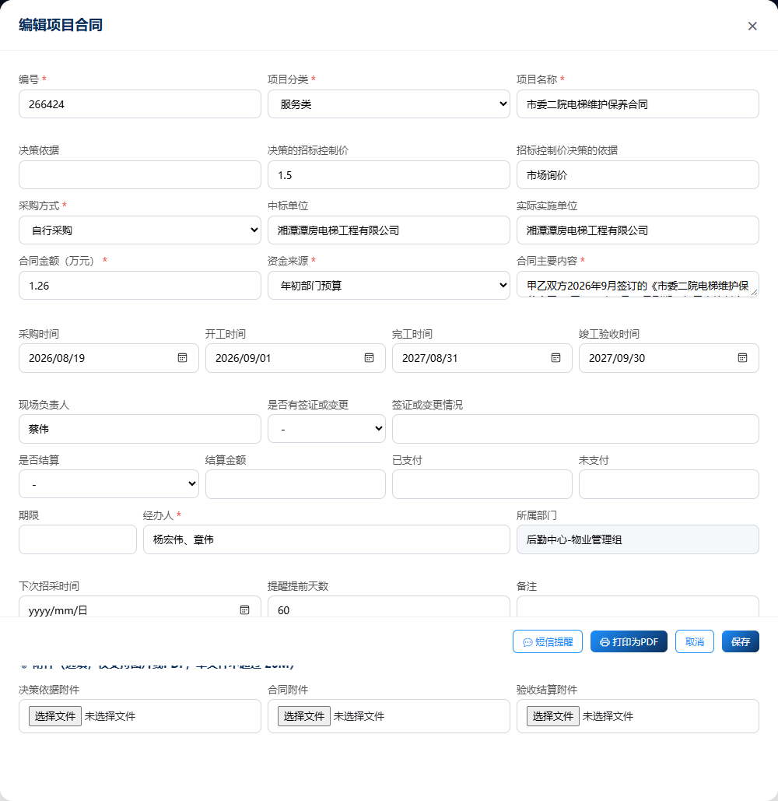

**填写要点：**

1. 带红色星号的为必填项：编号、项目分类、项目名称、采购方式、合同金额（万元）、资金来源、合同主要内容、经办人。
2. **合同编号**：打开弹窗时系统即按《合同编号规则》自动生成 6 位编号，编号栏**只读、不可手工修改**（规则与示例见 **4.11 合同编号规则**）。
3. **所属部门**：系统根据当前登录用户自动填充，且**不可手动修改**。
4. **提醒提前天数**：默认为全局配置值（如 60），可按需修改；留空时系统自动按全局默认值处理。
5. 日期字段通过日期选择器录入，格式为 `yyyy-mm-dd`（手工输入 `2026/1/9` 这类写法会被自动规范为 `2026-01-09`；`2026-13-40`、`2026-02-30` 等不存在的日期会被拒绝并提示具体字段）；金额字段填写数字，保留两位小数，**金额单位统一为“万元”**（表单中 `合同金额（万元）`、`决策的招标控制价（万元）`、`结算金额（万元）`、`已支付（万元）`、`未支付（万元）` 均已标注单位）。
6. 点击“保存”提交，成功后自动刷新列表；如编号重复或必填项缺失，系统会提示错误。
7. **资金来源**：必填下拉，取值固定为“年初部门预算、年中追加预算、统筹预算、上级专项转移支付、上年结转结余、其他”六项。
8. **字段校验规则（V1.8.4）**：项目分类、采购方式、资金来源、是否结算、是否有签证或变更只能取系统提供的标准选项（“是否结算”另有“部分结算”）；金额必须为数字且不小于 0；不满足时**保存失败并在对应字段下方给出中文原因**（例如“字段「合同金额（万元）」不是有效数字”），修正后再保存即可。

### 4.5 编辑项目合同

1. 在合同列表中找到目标合同，点击该行“操作”列的“编辑”按钮；也可以直接点击**列表中的项目名称**，或点击**首页“合同到期提醒 / 待收/支提醒”中的项目名称**，均可打开该项目对应的编辑弹窗。
2. 弹出表单的标题为“**编辑项目合同**”（新增时为“新增项目合同”）。
3. 在弹出表单中修改所需字段（“**所属部门**”与“**编号**”均为只读：编号由系统按规则生成并锁定，编辑时不可修改，保存后编号保持不变）。即使通过其它方式提交了不同的编号，服务端也会拒绝并提示“**合同编号由《合同编号规则》自动生成，不允许修改**”；如确需更正编号，请联系管理员处理。
4. 点击“保存”完成修改；每次修改会逐字段写入“日志审计 → 字段级变更日志”（记录修改前值与修改后值）。
5. **编辑时的校验宽松规则**：若某条历史记录的金额/日期等字段本身就是不规范的老数据（例如金额填成了文字），只要您**没有改动该字段**，仍可正常修改其它字段并保存；一旦把它改成新的非法值，同样会被拒绝。

> 权限说明：普通用户仅能编辑本部门或分管部门合同；查询用户无修改权限；已归档合同仅可浏览，不可编辑。

### 4.6 删除合同

1. 点击目标合同“操作”列的“删除”按钮。
2. 系统弹出二次确认对话框，**需填写删除原因**后点击“确认删除”。
3. 删除后该条记录被物理删除，不可恢复，请谨慎操作；删除原因会记录到“日志审计”。

### 4.7 合同归档

- 点击目标合同“操作”列的“归档”按钮（管理员或该合同经办人可操作）。
- 归档后该合同进入**只读状态**，所有用户仅可浏览，不可编辑、删除或上传附件。

### 4.8 附件管理

- 在新增/编辑合同弹窗中可按“决策依据附件、合同附件、验收结算附件”三类上传附件；
- 支持格式：图片（jpg/jpeg/png/gif/webp/bmp）与 PDF（格式白名单校验）；
- 单文件大小不超过“全局默认上传最大附件”设置值（默认 20M），超限文件将被拒绝；该值可在“系统设置”中调整；
- 附件文件与数据库一同纳入备份与恢复范围（见附录B）；
- 已上传附件可在合同列表中直接点击下载，也可在编辑弹窗中删除。
- **在线预览**：编辑弹窗的附件列表中，每个已保存附件后面新增「**预览**」按钮 —— 图片（jpg/jpeg/png/gif/webp/bmp）在弹窗内直接显示，PDF 使用内嵌阅读器打开，并可点"新窗口打开"；预览与下载**权限校验一致**（非本部门/分管部门合同的附件仍不可查看）。

> 提示：所有写操作（新增/编辑/删除/归档/导入）执行前系统都会自动备份数据文件，备份保留 30 天（详见附录B）。

### 4.9 打印为PDF

在合同列表点击“项目名称”进入合同浏览弹窗，右下角提供“打印为PDF”按钮（位于“关闭/取消”按钮之前）。

- 点击后系统**打开一个新标签页**，仅展示该合同的打印视图（不含系统导航栏、侧边菜单等无关元素），并自动弹出浏览器打印预览，可选择“另存为 PDF”保存。
- 打印内容与页面当前显示的合同数据完全一致，无需二次加载；包含合同全部字段（合同编号、项目分类、项目名称、决策依据、招标控制价、采购方式、中标单位、实际实施单位、合同金额、资金来源、结算金额、已支付、未支付、合同主要内容、采购/开工/完工/竣工验收时间、现场负责人、签证或变更情况、是否结算、期限、经办人、所属部门、下次招采时间、提醒提前天数、备注等）。
- 排版为 **A4 单页**：单条合同内容控制在 1 页内，字体、边距、行距已做紧凑优化，格式整洁。
- 打印视图背景带水印：`打印人：{当前登录用户姓名}　打印时间：YYYY-MM-DD HH:mm:ss`（示例：2026-08-21 14:30:00）；水印为小号浅灰、约 45° 倾斜，覆盖整页但不影响正文阅读，在打印预览与最终 PDF 中均可见。
- 建议使用 Chrome / Edge 浏览器打印，纸张选择 A4，边距使用默认值即可。

---

### 4.10 短信提醒（催办 / 点对点）

在“编辑项目合同”弹窗底部点击“**短信提醒**”，可对该合同单独发送催办短信或点对点短信，并可单独开关该合同的短信提醒。操作方式与弹窗界面见 **第十章“短信提醒”**。

---

### 4.11 合同编号规则（6 位自动编号）

新增项目合同时，系统按统一规则自动生成 6 位合同编号，格式为：

```
第 1-2 位 年度（如 2026 年记作 26）
第 3   位 科室（中心）序号
第 4   位 中心组室序号
第 5-6 位 顺序号（同一“年度+科室（中心）+中心组室”前缀下从 01 起，不足两位左侧补 0）
```

**第 3 位（科室 / 中心）**：1=办公室，2=国有资产科，3=公共事务科，4=人事科，5=财务科，6=后勤中心，7=资产中心，8=公车中心，9=政策法规科。

**第 4 位（中心组室）**：

| 科室（中心） | 第 4 位取值 |
|---|---|
| 局本级科室（第 3 位为 1、2、3、4、5、9） | 统一为 `1` |
| 后勤中心（第 3 位 6） | 1=综合组，2=公车组，3=工程组，4=物业组，5=后勤组，6=市民之家专班，7=周转住房专班 |
| 资产中心（第 3 位 7） | 1=综合组，2=房地资产组，3=通用资产组，4=集采组 |
| 公车中心（第 3 位 8） | 1=现场负责组 |

**示例（2026 年第一个合同）**：后勤中心物业组 `266401`；资产中心综合组 `267101`；资产中心房地资产组 `267201`；资产中心通用资产组 `267301`；资产中心集采组 `267401`；公车中心现场负责组 `268101`；政策法规科 `269101`；国有资产科 `262101`。

**使用要点**

1. 打开“新增项目合同”或“新增资产合同”弹窗时，系统立即生成编号并显示在“编号”栏，该栏**只读**（灰色，不能手工修改）；**编辑合同（编辑项目合同 / 编辑资产合同）时该栏同样只读**，编号不可修改、保存后保持不变。
2. 顺序号按“同一前缀下已有最大顺序号 + 1”生成；该前缀下还没有记录时，从 `01` 开始。同一“年度 + 科室（中心）+ 中心组室”最多 99 个，超出需扩展编号规则。
3. 项目合同编号写入台账的“编号”字段；资产合同编号写入资产合同的记录编号（列表“合同编号”列）。两者分别独立递增，互不影响。
4. 资产合同编号会随“管理部门”的选择自动重新生成（打开弹窗时默认按您的所属部门预生成），因此在资产合同弹窗中应先确认“管理部门”。
5. **历史合同编号一律保持不变**，不会因规则调整而重编或回填。
6. 若您所在科室（中心）/中心组室暂未配置编号规则（如“主任班子”“局领导”），弹窗中的编号栏为空且同样不可手工填写，点击“保存”时会提示“**当前科室（中心）未配置合同编号规则，无法生成编号**”。遇到该提示请联系管理员补充编号规则，之后再新增合同。

---

## 五、资产合同台账管理

点击左侧菜单“资产合同”，进入资产合同列表页面（页面标题为“资产合同台账”），可进行查询、新增、编辑、删除、归档、附件、导出、导入等操作（V1.3 新增模块，数据落在 `asset_contracts` 表）。

### 5.1 顶部工具栏

- **新增合同**：弹出新增资产合同表单（按钮文案与“项目合同台账”一致）。
- **导出**：按当前查询结果导出 Excel 文件（.xlsx）。
- **模板 / 导入**：管理员可下载资产合同导入模板，并按“导入预览 → 确认导入”的流程批量导入。
- **刷新**：重新加载最新数据。

### 5.2 查询与筛选

点击“搜索筛选条件”可展开/折叠，支持以下组合条件：

- 位置（下拉，取自库内现有位置）
- 资产名称、承租人、责任人（模糊查询）
- 管理部门（下拉，取自部门列表）
- 序号（按源表序号精确查询）
- 租期结束日（起/止）
- 归档状态（已归档 / 未归档）

设置条件后点击“搜索”执行查询，点击“重置”清空条件。

### 5.3 表格与分页

表格列为：**序号、资产名称、位置、承租人、联系电话、面积(㎡)、租期、年租金(元)、已缴租金合计(元)、责任人、操作**（V1.4 起**不再显示“缴款方式”列**；列表列与搜索筛选同步调整，合同级缴款方式字段已取消）。

- “**序号**”列取值来源为资产合同记录 **id**，列表按 id **降序**排列（最新录入的排在最前）。
- 列宽已优化（合计 100%）：序号 5%、资产名称 16%、位置 8%、承租人 9%、联系电话 8%、面积 7%、租期 9%、年租金(元) 8%、已缴租金合计(元) 9%、责任人 8%、操作 13%（操作列容纳“编辑/删除/归档”三个按钮），超长内容自动换行显示。
- 租期列由“租期开始日 至 租期结束日”自动拼接显示；金额列统一保留两位小数。
- “**已缴租金合计(元)**”列＝该资产合同下“租金收取明细”中所有记录的**实缴金额合计**（自动汇总，不是手工录入字段）。
- 点击**资产名称**或“操作”列的编辑按钮均可打开编辑弹窗；已归档记录整行置灰并显示“已归档，仅浏览”。
- 每页可切换 **20 条 / 50 条**，底部显示总条数与页码。

### 5.4 新增 / 编辑资产合同

弹窗标题为“新增资产合同 / 编辑资产合同”，表单分区块填写：

**1）“资产与承租人信息”区（3 行 × 4 列）**

| 行 | 字段（从左到右） |
|---|---|
| 第一行 | 资产名称（必填）、位置（必填）、承租人（必填）、联系电话 |
| 第二行 | 面积（㎡）、租期开始日（日期选择器）、租期结束日（日期选择器）、租期（只读，由租期起止日自动计算） |
| 第三行 | **年租金（元）**、**总合同额**（数字输入框，按“年租金（元）× 租期年数”自动计算，可手工修改）、**押金（元）**、**下次出租时间**（日期选择器，默认＝租期结束日 + 1 天，可手工修改） |

**2）“租金收取明细”区**（原“已缴租金明细”，V1.4 重构为动态明细表）：以表格管理该合同的租金收取记录，一个合同可多条（见下方“租金收取明细操作”）。

**3）其他（同一行 5 列）**：**合同编号（必填，位于“管理部门”之前）**、管理部门（下拉，取自部门列表）、责任人（多人用顿号分隔）、**提醒提前天数**（默认 60，取值范围 1~365）、备注。

**4）附件（选填）**：资产现状图片、决策依据附件、合同附件（见 5.7）。

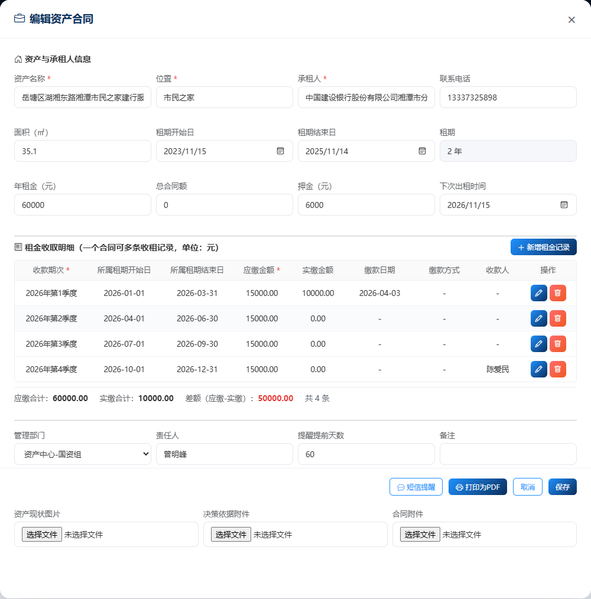

> 说明：
> - V1.3 起资产合同表单**不再包含“序号”输入框**，列表“序号”列由记录 id 自动生成；V1.4 起**不再有“租金信息”区**（“押金”上移至“资产与承租人信息”第三行，“季租/缴款方式”不再在表单中显示，已有数据保留）。
> - “总合同额”与“下次出租时间”均会随表单一起保存，保存后重新打开弹窗可见已保存的值。
> - 保存顺序为：先保存合同主表 → 再保存“租金收取明细”→ 最后上传本次新增附件；保存后列表自动刷新。
> - 必填项缺失、金额为负、日期格式不正确时系统会拦截并提示；租金明细中“收款期次”“应缴金额”为必填。
> - **合同编号**：即该资产合同的记录编号，打开弹窗时按《合同编号规则》自动生成并**锁定**（不可手工填写），选择/切换“管理部门”时会按新归属重新生成；保存时写入 `asset_contracts.id`，列表“合同编号”列即此编号（规则见 4.11）。

**租金收取明细操作（V1.4 新增）**

表格列为：**收款期次、所属租期开始日、所属租期结束日、应缴金额、实缴金额、缴款日期、缴款方式、收款人、操作**（表头与数据居中，默认无横向滚动条）。

1. **新增**：点击右上角“**新增租金记录**”，表格内直接插入一行可编辑行；**缴款方式默认选中“直缴非税”**，收款人默认取当前登录用户姓名，填完点该行“确定”（点“取消”则删除该行）。
2. **编辑**：点击某行“操作”列的铅笔按钮，该行转为可编辑；改完点“确定”保存到表单（点“取消”还原该行原值）。
3. **删除**：点击垃圾桶按钮并确认，该行从表单中移除（**点击弹窗底部“保存”后才会真正写入数据库**）。
4. **校验**：收款期次不能为空；应缴金额必填且不能为负；实缴金额可空（留空按 0）；日期必须为 `yyyy-MM-dd` 或留空；金额保留两位小数。
5. **实时汇总**：表格下方实时显示“应缴合计 / 实缴合计 / 差额（应缴−实缴，差额为正时标红）/ 共 N 条”。
6. **缴款方式**：下拉选择，取值仅 `直缴非税 / 现金 / 微信 / 其他`（可留空）。
7. **只读规则**：合同**归档**后（或当前用户为查询用户），明细表全部只读，新增/编辑/删除按钮不可用。

### 5.5 删除资产合同

1. 点击目标记录“操作”列的“删除”按钮。
2. 系统弹出二次确认对话框，**需填写删除原因**后点击“确认删除”。
3. 若该合同下存在**租金收取记录**，确认框会提示“该合同下有 N 条租金收取记录，将随合同一并删除”；数据库层为“限制删除”（RESTRICT），未确认时接口会拒绝并提示，确认后随合同一并删除这些收费记录。
4. 删除为物理删除，不可恢复；删除原因记录到“日志审计”（有关联收费记录时详情会注明“同时删除租金收取记录 N 条”）。已归档记录不可删除。

### 5.6 资产合同归档

- 点击目标记录“操作”列中“删除”按钮后面的“**归档**”按钮（管理员或该资产合同责任人可操作）。
- 归档后该记录进入**只读状态**：所有用户仅可浏览，不可编辑、删除或上传/删除附件，列表中显示“已归档，仅浏览”徽章。

### 5.7 附件管理

- 在新增/编辑资产合同弹窗底部，提供**三个**上传区：“**资产现状图片**”“**决策依据附件**”“**合同附件**”（组件样式与项目合同一致）。
- **资产现状图片**仅允许图片格式（jpg/jpeg/png/gif/webp/bmp）；决策依据附件与合同附件支持图片与 PDF；单个文件大小不超过“全局默认上传最大附件”设置值（默认 20M），超限或格式不符将被拒绝。
- **在线预览**：资产合同附件的「资产现状图片」等已保存附件同样支持点击「**预览**」在弹窗内查看（图片直接显示、PDF 内嵌阅读），便于现场核对房屋/设备现状照片。
- 已上传附件在弹窗内可点击下载（回显文件列表），也可通过条目右侧“×”删除。
- 附件文件与数据库一同纳入备份与恢复范围（见附录B）。

### 5.8 导入 / 导出 / 模板

- **导出**：按当前筛选条件导出资产合同台账 Excel，包含序号、管理部门、责任人、下次出租时间、总合同额、提醒提前天数等全部字段。
- **模板 / 导入**（管理员）：模板列与导出列一致；导入流程为“导入预览（逐条校验：可导入 / 不可导入及原因）→ 确认导入 → 导入结果（新增 / 跳过）”，错误行不会导入。必填列：位置、资产名称、承租人。

### 5.9 打印为PDF

与项目合同一致：打开“编辑资产合同”弹窗后，点击底部工具栏中的**“打印为PDF”**按钮，系统会在新窗口中生成一份版式为 A4 的《资产合同台账信息》打印稿，并自动调起浏览器打印对话框（可直接打印或“另存为 PDF”）。

打印内容包含：资产名称、位置、序号、承租人、联系电话、责任人、管理部门、面积、租期起止、押金、年租金、季租、总合同额、下次出租时间、提醒提前天数、备注；若该资产合同存在**租金收取明细**，会额外附一张明细表（收款期次、所属租期、应缴金额、实缴金额、缴款日期、缴款方式、收款人）。页面带“打印人 / 打印时间”水印，便于溯源。

> 同理，“编辑项目合同”弹窗中的“打印为PDF”打印的是《合同台账信息》。

### 5.10 数据范围与权限

- 管理员可见全部资产合同。
- 普通用户与查询用户的可见范围＝本部门 + 分管部门（按资产合同的“**管理部门**”精确匹配）；合同列表、查询统计、导出、详情查看、附件下载，以及首页“总合同数 / 总合同额 / 已-将到期合同数”卡片与到期提醒中的资产部分均按同一口径过滤。
- 查询用户只读（不可新增/修改/删除/归档）；普通用户与管理员可新增、修改、删除；**归档**仅管理员或该资产合同“责任人”可执行。
- 资产合同的写操作（新增、修改、删除、归档、导出、下载模板、导入、附件上传/删除、永久关闭提醒）均写入“日志审计 → 操作日志”，模块名为“资产合同台账”；字段修改同时进入“字段级变更日志”。

---

## 六、查询统计

点击左侧菜单“查询统计”，进入统计分析页面。页面顶部提供两个选项卡：“**项目合同查询统计**”（默认选中）与“**资产合同查询统计**”，点击即可切换，两个选项卡的统计内容互不影响。

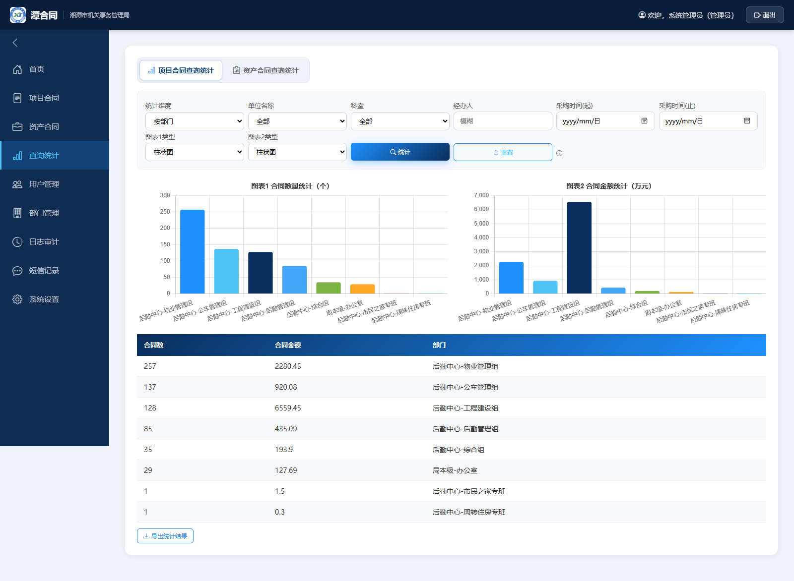

### 6.1 项目合同查询统计·操作步骤

1. 选择**统计维度**：
   - 按部门（单位+科室）
   - 按时间（年/季度）
   - 按经办人
   - 按项目分类
   - 按资金来源
   - 按部门支付情况
   - 按项目支付情况
   - 按部门预算执行情况
   - 按项目预算执行情况
2. 选择**图表类型**：柱状图 / 饼图 / 折线图 / 环形图。
3. 可按需设置查询条件（单位、科室、经办人、采购时间起止、年份等），统计结果与条件联动。
4. 点击“统计”按钮生成统计结果。
5. 点击“重置”按钮可清空筛选条件（统计维度恢复为“按部门”，单位、科室、经办人、采购时间起止、年份恢复为默认）并自动重新统计。

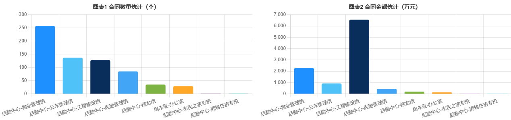

### 6.2 项目合同查询统计·图表说明

- 按部门/项目分类/资金来源/经办人/时间统计时：**图表1** 展示“合同数量统计”，**图表2** 展示“合同金额统计（万元）”。
- 按部门/项目支付情况：**图表1** 对比“未支付金额与已支付金额”，**图表2** 对比“合同金额与未支付金额”（万元）。
- 按部门/项目预算执行情况：**图表1** 对比“招标控制价与合同金额”（万元），**图表2** 展示“偏差率（%）”。
- 两张图表可分别独立切换图表类型，便于对比分析。
- 下方统计明细表格展示具体数据，可点击“导出统计结果”导出为 Excel。

### 6.3 项目合同查询统计·指标口径

- **未支付金额**：优先取合同台账“未支付”字段；该字段为空时，按“合同金额 - 已支付”自动计算。
- **预算执行对比**：招标控制价与合同金额均按所选分组汇总求和；差额 = 合同金额合计 - 招标控制价合计；偏差率 = 差额 ÷ 招标控制价合计 × 100%（招标控制价合计为 0 时不计算偏差率）。
- 统计范围与查询条件（单位、科室、经办人、采购时间起止、年份）联动，口径与合同列表一致。

> 说明：按部门统计时，图例中的部门名称会统一使用简称，例如“湘潭市机关事务管理局后勤中心-物业管理组”显示为“局后勤中心-物业管理组”。
> 数据范围：管理员统计全部合同；普通用户与查询用户仅统计本部门及分管部门范围内的合同。

### 6.4 资产合同查询统计

点击“**资产合同查询统计**”选项卡，页面布局与“项目合同查询统计”一致：上部为筛选条件，中间为两张图表，下方为统计明细表与“导出统计结果”按钮。

- **统计维度**：按部门、按时间、按经办人（责任人）。
- **筛选条件**：单位名称、科室、经办人（责任人）、出租时间（起）、出租时间（止）。
- **图表**：图表1 为“资产数量统计（个）”，图表2 为“**年租金与已缴租金对比（元）**”；两张图表可分别独立切换柱状图 / 饼图 / 折线图 / 环形图。
- **明细表**：管理部门/责任人/时间、资产数、面积合计（㎡）、**年租金合计（元）**、**已缴租金合计（元）**。
- **指标口径**：年租金合计＝各资产合同“年租金（元）”之和；**已缴租金合计＝各资产合同“租金收取明细”中实缴金额之和**（即该合同所有收款记录的实缴合计，再按分组维度求和；无收款记录计 0）。
- **导出统计结果**：按当前筛选条件导出资产合同明细 Excel。
- **数据范围**：与资产合同台账一致，按“管理部门”＝本部门 + 分管部门过滤（管理员全部可见）。

> 说明：“按时间”维度以资产合同的“租期开始日”所在年份、季度分组。

---

## 七、用户管理（仅管理员）

点击左侧菜单“用户管理”，进入用户管理页面，可维护部门信息和系统用户。

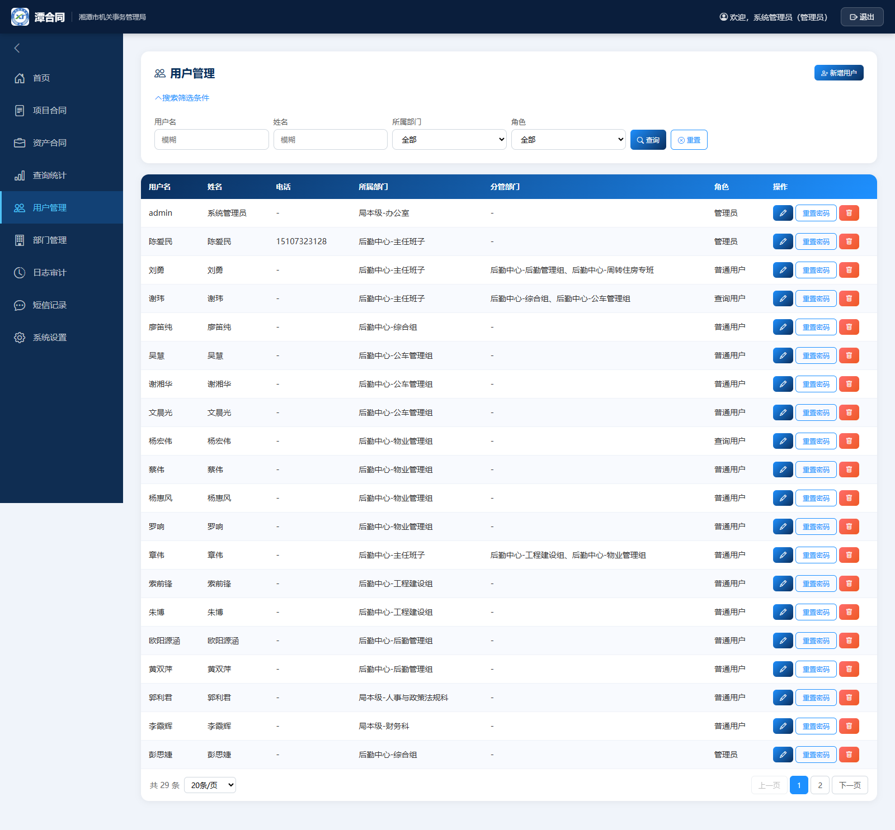

### 7.1 部门维护

1. 点击页面顶部的“部门维护”按钮，弹出部门管理对话框。
2. 对话框中列出已有部门（单位名称 + 科室名称组合）。
3. **新增部门**：输入单位名称与科室名称，点击新增。
4. **删除部门**：点击对应部门的删除按钮；若该部门下存在关联用户，系统会提示无法删除。

> 说明：部门组合“单位名称-科室名称”全局唯一，用户和合同的“所属部门”均取自该列表。

### 7.2 用户列表

用户列表展示：用户名、姓名、所属部门、角色、操作。

| 角色 | 说明 |
|------|------|
| 管理员 | 可维护用户、部门、系统设置，可操作所有合同，查看所有统计与提醒。 |
| 普通用户 | 可新增合同；编辑、删除本部门及分管部门合同；接收本部门+分管部门合同的到期提醒与待收/支提醒。 |
| 查询用户 | 仅可查询、统计、导出合同，查看提醒列表（含待收/支提醒），无修改权限。 |

### 7.3 新增 / 编辑用户

1. 点击“新增用户”按钮（或用户列表中的“编辑”）。
2. 填写用户名、姓名，选择所属部门（从已有部门组合中选择）与角色。
3. 如所属部门为领导岗位（局领导、主任班子、中心班子），可勾选“分管部门”授予管理范围。
4. 保存后生效；新用户默认密码为 `123456`。

### 7.4 重置密码

- 点击用户列表中的“重置密码”按钮，该用户密码将被重置为 **`123456`**。
- 重置后请及时通知用户修改或使用新密码登录。
- **重置后该用户首次登录会被强制要求修改密码**（V1.8.5 起）：其登录失败次数与锁定状态同时清零；该用户用 `123456` 登录后会弹出「请先修改密码」对话框，改密成功后才能使用其它功能。

### 7.5 删除用户

- 点击用户列表中的“删除”按钮并二次确认后删除该用户；默认管理员 `admin` 不可删除。

### 7.6 用户数据批量导入（通讯录）

> 本节由**系统管理员 / 系统维护人员**执行，普通用户无需操作。系统当前**没有“用户导入”界面按钮**，批量导入由维护脚本完成（支持先预演、再正式执行）。

1. **导入新用户**（脚本 `_import_users_2026_09.py`）：按单位提供的通讯录（xlsx）批量新增用户。
   - 已有用户**一律不修改**（“用户名”为主键）；
   - 通讯录中存在、系统中没有的才新增；
   - 新增用户默认密码 **`123456`**、角色为“普通用户”；
   - 手机号按文本写入；所属部门必须是**已有部门**（不存在请先按 7.1 补建）。
2. **补齐联系电话**（脚本 `_fill_phones_2026_09.py`）：按通讯录只补齐缺失的“电话”，**不覆盖**已有号码，不改动所属部门、角色、密码与分管部门；`admin` 不动。
3. **按层级重排用户顺序**（脚本 `_reorder_users.py`）：按“局本级（局领导 → 办公室 → 国有资产科 → 公共事务科 → 人事科 → 财务科 → 政策法规科）→ 后勤中心 → 资产中心 → 公车中心”的顺序重排用户列表；科室内按通讯录序号排列，通讯录中没有的人员排在该科室末尾。**只改显示顺序，不改任何字段值。**
4. 脚本统一支持两种模式：`dry`（预演，只打印将要发生的变更、不写库）与 `run`（先自动备份数据库再写入）。执行后请在“用户管理”核对人数、部门与电话是否正确。

> 本轮导入结果：用户由 29 人增至 **54 人**（管理员 9、普通用户 44、查询用户 1），部门由 15 个增至 **22 个**，53 人已登记联系电话。

---

### 7.7 修改本人密码 / 用户名（所有角色通用）

除管理员可在“用户管理”中为他人重置密码外，**每位用户都可以自助修改自己的密码或用户名**：

1. 登录后点击**右上角的「修改密码」按钮**；也可以进入左侧「用户管理」菜单，使用页面下方的「**账号设置**」卡片（管理员在用户列表下方同样能看到这张卡片）；
2. 卡片顶部显示当前账号、姓名、部门与角色，按需填写：
   - **新用户名**：留空表示不修改；填写则不能与已有用户名重复；
   - **原密码**：修改密码时**必填**（用于校验身份）；
   - **新密码** / **确认新密码**：留空表示不修改；两次输入必须一致，且需满足密码规则（≥8 位、不能为纯数字或纯字母、不能与用户名相同、不能为 `123456` 等弱口令）；
3. 点击「确认修改」，成功后提示“修改成功”；密码**立即生效**，用户名变更后界面右上角同步更新。

> 说明：用户名为**登录账号**，修改后请用新用户名登录；若忘记原密码，请联系管理员在“用户管理”中重置（重置后您需在下次登录时自行设置新密码）。

---

## 八、系统设置（仅管理员）

点击左侧菜单“系统设置”，进入系统设置页面。

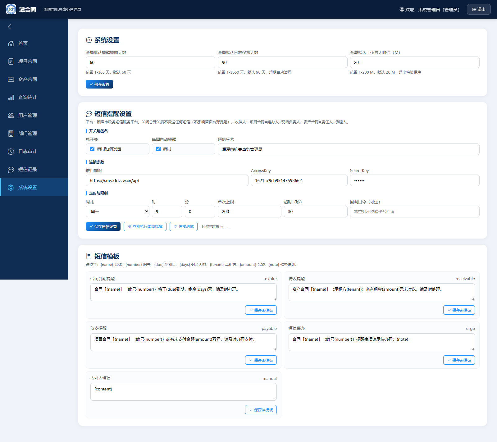

### 8.1 全局默认提醒提前天数

1. 在“默认提醒天数”数字输入框中输入新的天数（系统允许范围为 1～365，默认值为 60）。
2. 点击“保存”按钮。
3. 保存成功后提示“保存成功”，设置**即时生效**（无需重启系统）。

> 说明：该值为合同“提醒提前天数”为空时的兜底取值。修改后，后续所有提醒计算均按新值执行；各合同若单独设置了提醒天数，则优先使用合同自身设置。

### 8.2 日志保留天数

1. 在“日志保留天数”输入框中输入新的天数（默认 90 天）。
2. 点击“保存”按钮。
3. 超过保留天数的历史操作日志将在系统运行中自动清理。

### 8.3 全局默认上传最大附件

1. 在“全局默认上传最大附件”输入框中输入新的上限（允许范围 1～200，默认 20）。
2. 点击“保存”按钮。
3. 保存后即时生效；后续附件上传超过该上限将被拒绝（含合同新增/编辑中的附件上传）。

### 8.4 短信提醒设置与短信模板

系统设置页面下方另有“**短信提醒设置**”与“**短信模板**”两块，用于配置短信平台参数（总开关、签名、AK/SK、每周提醒时间、超时、连接测试等）与 5 类短信模板正文。完整说明与界面截图见 **第十章“短信提醒”**。

### 8.5 会话空闲超时（分钟）

1. 在“会话空闲超时（分钟）”输入框中输入新的时长（允许范围 **1～1440** 分钟，默认 **30** 分钟）；
2. 点击“保存”按钮，提示“设置已保存”；
3. 生效范围：用户登录后若连续**无任何操作**（鼠标移动、键盘输入、点击）超过该时长，系统将**自动退出登录**并提示“长时间未操作，已自动退出，请重新登录”。

> 说明：① 该时长按“滑动窗口”计算——只要有操作就重新计时；② 保存后**新登录**的会话即刻按新值执行，已登录的会话仍按登录时的时长执行；③ 服务端同样会校验空闲时长，超时会话的后续请求会被拒绝并提示“会话已超时，请重新登录”。

---

## 九、日志审计

点击左侧菜单“日志审计”，页面分为上下两个区域，均支持筛选条件折叠/展开、分页（20/50/100 条每页）：

### 9.1 操作日志（审计）

- **筛选条件**：开始日期、结束日期、操作用户（仅管理员可见，支持用户名/姓名模糊匹配）、操作模块（用户登录/合同台账/用户管理/部门管理/系统配置）、操作类型（登录、登出、新增、修改、删除、归档、导入、导出、上传附件、删除附件、清空提醒、新增用户…修改配置等）。
- **按钮**：“查询”“重置”，管理员另有“导出”（导出 xlsx，导出动作自身留痕）与“刷新”。
- **列表列**：时间、用户名、姓名、角色、IP 地址、模块、操作类型、对象、详情、结果（成功/失败徽章）。
- **数据范围**：管理员可查看全部日志，普通用户仅查看本人日志。
- **筛选区与列表已合并到同一张卡片**中展示（筛选条件、日志表格、分页在同一区域），界面更紧凑。

### 9.2 字段级变更日志

记录“谁在什么时间把某个合同的哪个字段从什么值改成了什么值”，用于追踪数据变动明细。

- **筛选条件**：开始日期、结束日期、操作用户（仅管理员可见）、操作模块（合同台账 / 资产合同台账）、字段名（下拉，选项由系统按已有日志自动列出）。
- **按钮**：“查询”“重置”“刷新”。
- **列表列**：时间、姓名、模块、对象（编号 · 名称）、字段、原值、新值（空值显示“（空）”）。
- **记录范围**：项目合同与资产合同的新增、修改、归档、清空提醒（永久关闭提醒），以及**资产合同“租金收取明细”的保存**；仅记录**实际发生变化的字段**，一个字段一行。
- **租金明细的字段名**：修改记为 `租金明细[收款期次]·列名`（例如 `租金明细[2026年第1季度]·实缴金额（元）`），整条新增/删除记为 `租金明细[收款期次]`（值中记应缴/实缴/缴款日期/缴款方式/收款人摘要）。
- **去噪**：数值仅写法不同（如 `0` 与 `0.0`、`150000` 与 `150000.0`）不算变更，不会产生日志。
- **数据范围**：管理员可查看全部记录，普通用户仅查看本人操作产生的记录。
- **维护人员执行的批量数据调整**：由管理员用一次性脚本调整数据（如批量修改“所属部门”、清洗不合规金额）时，也会逐条写入本日志，操作人显示为「**数据调整脚本**」或「**数据清洗脚本**」，模块为“合同台账”，便于事后追溯（详见开发文档 7.6）。

> 举例：项目合同“256331”的“下次招采时间”被修改后，可在此按模块“合同台账”＋字段名“下次招采时间”＋日期范围查询到修改前后的值与操作人。
> 举例：把某资产合同“2026年第1季度”的实缴金额从 0 改为 1000 后，可在此按模块“资产合同台账”＋字段名“实缴金额（元）”查到一条 `租金明细[2026年第1季度]·实缴金额（元）`、原值 `0`、新值 `1000` 的记录。

---

## 十、短信提醒

> 本章为 V1.5 新增。短信通过**湘潭市政务短信服务平台**下发，需由管理员在“系统设置”中开启并配置；且服务器需具备访问该平台的网络条件（政务网策略）。

### 10.1 功能概览

系统在以下三种提醒场景下，可自动或手动向相关人员发送提醒短信：

| 场景 | 项目合同收件人 | 资产合同收件人 |
|------|----------------|----------------|
| 合同到期提醒（下次招采 / 下次出租） | 经办人、现场负责人 | 责任人、承租人 |
| 待支提醒（未支付金额 > 0） | 经办人 | — |
| 待收提醒（租金应收未收） | — | 责任人、承租人 |

- **手机号来源**：经办人、现场负责人、责任人取自“用户管理”中该用户的“电话”字段；承租人取自资产合同自身的“联系电话”字段。
- **每人一条**：同一提醒在同一周内，对同一手机号只发送一条。
- **每周一次**：默认每周一 09:00 自动执行一次；周几与时间可在“系统设置 → 短信提醒设置”中修改。
- **停止发送的条件**：该合同已归档、或已办结（款项已收齐 / 已付清）、或“短信提醒”开关被关闭、或已清空提醒日期（永久关闭提醒）。
- **缺少号码不发送**：用户未填写电话、或承租人未填写联系电话时跳过该收件人，并在“短信记录”中留下失败痕迹。
- **每条短信末尾会自动追加机构署名「（湘潭市机关事务管理局）」**（取“系统设置 → 署名文本”，可在“正文末尾署名”开关中关闭）。署名使用**全角括号**；正文中**不得包含「【】」**（平台会判定为多签名并直接阻断）。

### 10.2 短信发送记录

点击左侧菜单“**短信记录**”，进入短信发送记录页面：

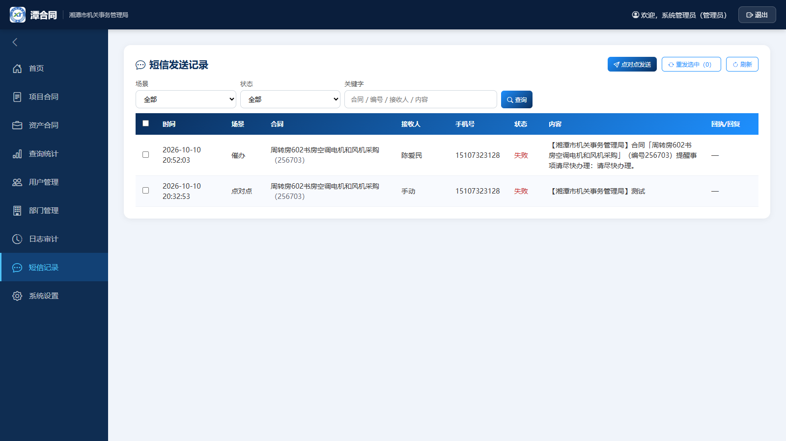

- **筛选条件**：场景（到期提醒 / 待收提醒 / 待支提醒 / 催办 / 点对点）、状态（成功 / 失败 / 待发送）、关键字（合同名称、编号、接收人、短信内容）；点“查询”后生效。
- **列表列**：时间、场景、合同、接收人、手机号、状态、内容、回执/回复。
- **数据范围**：管理员可见全部记录；其他用户仅可见本人触发的记录。
- 短信平台的回执与对方回复会自动回写到对应记录的“回执/回复”列。

### 10.3 点对点发送（自填号码）

1. 在“短信记录”页面点击右上角“**点对点发送**”。
2. 填写接收手机号（多个用逗号分隔，单次最多 50 个）与短信内容（不超过 500 字）。
3. 点击“发送”。系统会在正文末尾自动追加署名「（湘潭市机关事务管理局）」并逐条下发，完成后提示“发送 N 条，跳过 N 条，失败 N 条”。

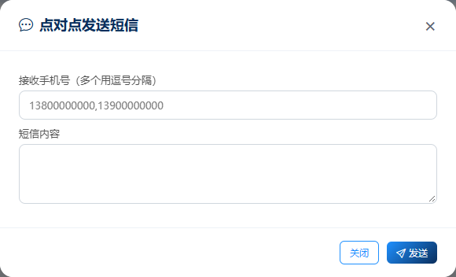

> 该方式不绑定具体合同，发送记录中“合同”列显示为“—”。

### 10.4 失败重发

1. 在“短信记录”页面勾选状态为“**失败**”的记录；表头勾选框可一键全选当前列表中的失败记录。
2. 点击“**重发选中（N）**”。
3. 在确认弹窗中点击“确认重发”。

> 说明：重发使用原手机号与原短信内容；**原失败记录保留**，系统另生成一条“触发方式=重发”的新记录，便于追溯。单次最多重发 50 条；查询用户无权重发，普通用户只能重发本人触发的记录。

### 10.5 合同内的短信催办与点对点

在“编辑项目合同”或“编辑资产合同”弹窗底部点击“**短信提醒**”：

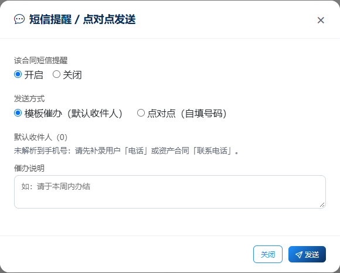

- **该合同短信提醒**：可单独开启 / 关闭该合同的短信提醒（关闭后该合同不参与自动提醒与催办，仍可手动点对点发送）。
- **发送方式**：
  - **模板催办（默认收件人）**：按 10.1 的规则自动列出该合同的收件人及手机号，填写“催办说明”后发送；
  - **点对点（自填号码）**：自行填写手机号与短信内容。
- 页面会显示“默认收件人（N）”及其手机号，便于发送前核对；若提示“未解析到手机号”，请先到“用户管理”补录该用户的“电话”，或补填资产合同的“联系电话”。
- 点击“发送”后，结果会显示在弹窗内，并同步写入“短信记录”。

### 10.6 短信设置（仅管理员）

点击左侧菜单“系统设置”，页面下方为“**短信提醒设置**”与“**短信模板**”两块：

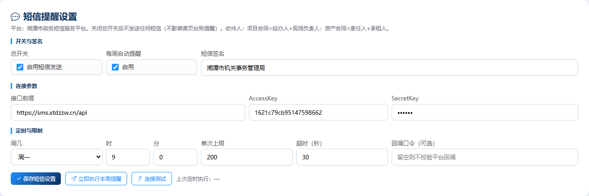

1. **总开关**：默认关闭，需勾选“启用短信发送”后系统才会下发短信。
2. **每周自动提醒**：勾选后按设定的周几 / 时 / 分自动执行，默认每周一 09:00。
3. **接口前缀 / AccessKey / SecretKey**：由短信平台提供；SecretKey 留空表示不修改（页面仅回显掩码）。
4. **单次上限 / 超时（秒）/ 回调口令**：分别表示单次任务最多发送条数、连接与读取超时（政务内网较慢时可调大）、回执回调校验口令（可留空）。
5. **内容与频率限制（平台规范）**：正文末尾署名开关与**署名文本**、单段字数、最多分段、敏感词开关与词表、每号每日上限、同号最小间隔（详见 10.7）。
6. 点击“保存短信设置”保存以上配置。
7. 点击“**连接测试**”可直接探测服务器与短信平台的网络连通性（依次检测域名解析、`sms.xtdzzw.cn:443`、`10.129.17.93:443`），该操作**不发送短信**。
8. 点击“**立即执行本周提醒**”可手动触发一次本周的到期 / 待收 / 待支提醒，用于调试或补发。
9. **短信模板**：可修改 5 类模板正文（到期提醒、待收提醒、待支提醒、催办、点对点），支持的占位符见页面提示；修改后点击“保存该模板”生效。

> 提示：早期版本设置页曾有一个「短信签名」输入框（用于在正文前拼接 `【签名】正文`），因与平台“内容不得含【】”的规范冲突，**已删除**；署名统一由“内容与频率限制（平台规范）→ 署名文本”维护。

> **常见提示**：若“连接测试”显示 TCP 连接超时，说明服务器到短信平台的网络不通。请确认本机位于政务网内，并已开通 `sms.xtdzzw.cn:443`、`10.129.17.93:443` 网络策略及调用方 IP 白名单。

### 10.7 平台使用规范与发送限制（重要）

政务短信平台对发送内容与频率有明确规范，**系统已按规范做了自动校验与拦截**：

| # | 平台规范 | 系统处理 |
|---|---|---|
| 1 | 单条内容不宜过长，过长需分解多条发送 | 超出「单段字数」（默认 70 字）时按标点自动拆分多条发送；超过「最多分段」（默认 3 段）则拒绝并提示精简内容 |
| 2 | 内容**不能包含「【】」**中括号（会被判定为多签名、直接阻断） | 发送前拦截：手动输入时即时提示、保存模板时拒绝；系统在正文末尾追加的是**全角括号署名**「（湘潭市机关事务管理局）」，不是中括号 |
| 3 | 内容不能包含敏感关键字（楼价 / 打折 / 特价 / 优惠 等） | 按「敏感词表」逐词校验，命中即拦截并提示命中的词；词表可在系统设置中维护 |
| 4 | 号码必须是手机号码且有效（固话、虚假号码会失败） | 发送前校验，仅接受 11 位手机号；无效号码不发送，并在发送结果中说明原因 |
| 5 | 同一号码每天最多发送 100 条 | 发送前统计该号码当日**成功**条数，达到「每号每日上限」（默认 100，平台硬性上限）即拦截 |
| 6 | 验证码类短信需设置重复发送间隔 | 本系统不发送验证码；为避免重复下发，仍按「同号最小间隔」（默认 30 秒）对同一号码限流 |

> 被拦截的记录**不会发出**，会在发送结果区域逐条列出原因（如“✘ 13800000000：内容含敏感词：优惠”），修改后可重新发送。
> 周一自动提醒不受第 6 条影响：同一批任务中，同一个人可能同时收到到期/待收/待支提醒，系统按“批次开始前状态”统一判定，不会互相限流。

上述各项均可按本单位需要调整：**系统设置 → 短信提醒设置 → 内容与频率限制（平台规范）**（正文末尾署名开关与署名文本、单段字数、最多分段、敏感词开关与词表、每号每日上限、同号最小间隔）。

---

## 十一、退出系统

1. 点击主界面右上角的“退出”按钮。
2. 系统清除当前登录会话，自动返回登录界面。
3. 为保障数据安全，使用公用电脑时请务必在离开前退出系统。

---

## 附录A：到期提醒与颜色说明

在首页“合同到期提醒”列表中，每条提醒的状态胶囊按“剩余天数”显示：

| 剩余天数 | 状态胶囊 | 颜色 | 含义 |
|----------|----------|------|------|
| 剩余天数 < 0 | 已过期 N 天 | 浅红底深红字 | 已超过提醒触发日（项目合同为“下次招采时间”，资产合同为“下次出租时间”），务必尽快处理。 |
| 0 ≤ 剩余天数 ≤ 15 | N 天后到期 | 浅黄底深橙字 | 已进入提醒窗口且临近，需要关注。 |
| 剩余天数 > 15 | N 天后到期 | 浅绿底深绿字 | 已进入提醒窗口，尚有处理时间。 |

> 其中“提醒天数”（进入提醒窗口的提前量，默认 60 天）取合同/资产合同自身的“提醒提前天数”，为空时使用全局默认值；胶囊颜色按上表的“剩余天数”区间显示，与提醒窗口天数相互独立。

---

## 附录B：数据备份与恢复规则

- 系统在每次写操作（新增、编辑、删除、归档、导入等）前，自动对数据库进行备份：
  - 备份目录：项目下 `backups/` 文件夹；
  - 备份文件名格式：`合同台账_YYYYMMDD_HHMMSS.db`（精确到秒）；
  - 保留策略：备份文件保留 **30 天**，超期自动清理。
- **恢复方法**：如需恢复数据，请联系系统管理员；管理员可在停止服务后将所需备份文件复制替换至 `data/合同台账.db`，同时恢复 `data/attachments/` 附件目录（项目合同附件与资产合同附件均存放于该目录）。
- 普通用户无需自行备份；如发生数据异常，请及时联系管理员处理。

---

## 附录C：常见问题（FAQ）

**Q1：登录时提示“用户名或密码错误”？**
答：请确认账号与密码输入无误；若忘记密码，请联系管理员在“用户管理”中重置密码为 `123456`。

**Q2：为什么我看不到“用户管理”“系统设置”菜单？**
答：这两个菜单仅对角色为“管理员”的用户可见，请使用管理员账号登录。

**Q3：为什么我只能编辑部分合同？**
答：普通用户只能编辑、删除“所属部门”为本部门或分管部门的合同；如需调整部门归属，请联系管理员。

**Q4：某条合同一直出现在到期提醒里？**
答：该合同满足提醒规则（下次招采时间非空、已进入提醒窗口，且属于您的可见范围；含已归档合同）。如需不再提醒，可在提醒列表中点击“永久关闭”（需二次确认），将清空该合同的下次招采时间；已归档合同仅可“忽略”。

**Q5：修改“系统设置”中的默认提醒天数后，已有合同会变吗？**
答：新值立即生效。已单独设置“提醒提前天数”的合同仍按自身设置计算，仅未单独设置的合同使用新的全局默认值。

**Q6：导出的 Excel 文件包含哪些列？**
答：导出的 Excel 包含全部 29 列台账字段，日期字段统一为 `yyyy-mm-dd` 格式。

**Q7：系统备份到哪里？**
答：只有发生写操作（新增/编辑/删除/归档/导入）时才会自动备份，备份文件保存在项目 `backups/` 目录（数据库文件 `.db`，保留 30 天）；纯查询不产生备份。

**Q8：删除合同为什么要填写原因？**
答：删除为不可恢复操作，填写原因用于审计留痕，原因会记录在“日志审计”中，满足机关经办与审批分离的管理要求。

**Q9：附件支持哪些格式？大小有限制吗？**
答：支持图片（jpg/jpeg/png/gif/webp/bmp）与 PDF 格式，上传时系统校验格式白名单；单文件大小默认不超过 20M（可在“系统设置”中调整“全局默认上传最大附件”），超限将被拒绝。

**Q10：为什么我看不到其他部门的合同提醒？**
答：普通用户与查询用户仅接收本部门及分管部门范围内合同的到期提醒；管理员可查看全部提醒。

**Q11：为什么某条合同没有出现在“待收/支提醒”里？**
答：该列表由两部分组成，判定条件分别是：① 待支（项目合同）——未归档（归档状态为“否”或空）、待支付金额大于 0（优先取“未支付”字段，为空时按“合同金额 − 已支付”计算）；② 待收（资产合同）——其“租金收取明细”中 `Σ应缴金额 − Σ实缴金额 > 0`（即存在未收齐差额）。此外还需属于您的可见数据范围（项目按“所属部门”、资产按“管理部门”）。

**Q12：点击“打印为PDF”没有弹出新标签页？**
答：请检查浏览器是否拦截了弹窗（地址栏附近会有拦截提示），允许该站点弹窗后重试；若仍被拦截，系统会自动改用当前页内的隐藏方式触发打印预览。

**Q13：导入时提示“数据库约束拒绝写入”是什么意思？**
答：说明该行存在必填字段为空、编号重复、金额为负或日期格式错误等问题，请按提示检查对应行后重新导入；系统不会静默修改您的数据。

**Q14：为什么我看不到“资产合同”菜单？**
答：“资产合同”菜单对所有登录用户可见（V1.3 新增）。若看不到，请先退出后重新登录，或确认系统已升级到 V1.3 版本。

**Q15：为什么我只能看到部分资产合同？**
答：普通用户与查询用户的可见范围为本部门 + 分管部门，资产合同按“**管理部门**”字段匹配该范围；管理员可见全部资产合同。列表、查询统计、导出、详情、附件下载以及首页卡片/提醒中的资产数据均按此口径一致过滤。

**Q16：资产合同的“总合同额”“下次出租时间”为什么和我填的不一样？**
答：这两项都会保存您填写（或系统自动计算）的结果：“总合同额”默认按“年租金（元）× 租期年数”自动计算，但可手工修改，保存后以您填写的值为准；“下次出租时间”默认等于“租期结束日 + 1 天”，也可手工修改。若打开弹窗后显示的仍是旧值，请确认是否点击了“保存”。

**Q17：资产合同能上传哪些附件？**
答：附件为选填，共两个上传区——“决策依据附件”和“合同附件”；仅支持图片（jpg/jpeg/png/gif/webp/bmp）与 PDF，单文件大小默认不超过 20M（可在“系统设置 → 全局默认上传最大附件”调整）。已上传的附件可下载或删除；资产合同归档后不可再上传或删除附件。

**Q18：在哪里能看到某个字段被谁改过？**
答：在“日志审计 → 字段级变更日志”中查询，可按日期范围、操作用户、操作模块、字段名筛选，列表显示修改前后的值；记录范围包括项目合同与资产合同的新增、修改、归档、清空提醒操作。

**Q19：首页卡片里的数字口径与提醒列表一致吗？**
答：“已/将到期合同数”卡片与“合同到期提醒”列表口径一致（项目合同按“下次招采时间”、资产合同按“下次出租时间”，并合并计数）；“总合同数”= 项目合同数 + 资产合同数；“总合同额”= 项目合同金额合计 + 资产合同“总合同额”合计（资产合同按元录入，展示统一折算为万元）。三张卡片的文字标签或问号图标均可悬停查看项目/资产的构成与占比。

---

**Q20：为什么相关人没有收到短信提醒？**
答：请依次检查：① 管理员在“系统设置 → 短信提醒设置”中是否已勾选“启用短信发送”、签名与 AK/SK 是否已配置；② 收件人是否有手机号——经办人/现场负责人/责任人的手机号取自“用户管理”的“电话”字段，承租人取自资产合同的“联系电话”字段，缺失则不会发送；③ 该合同是否满足停止条件（已归档、已办结、单合同短信开关为“关闭”、已清空提醒日期）；④ 服务器到短信平台的网络是否连通，可在设置页点击“连接测试”确认。以上情况均可在“短信记录”中查看对应痕迹。

**Q21：“连接测试”或发送时提示“连接短信平台超时”？**
答：说明服务器到短信平台的网络不通，属于网络策略问题而非系统故障。短信平台需在政务网内访问，请确认本机/服务器在政务网内，并已开通 `sms.xtdzzw.cn:443`、`10.129.17.93:443` 网络策略及调用方 IP 白名单。网络打通后再发送即可；此前的失败记录可在“短信记录”中勾选后点击“重发选中”。

**Q22：同一条提醒会不会重复发很多条？**
答：不会。系统按“每人一条”控制：同一提醒在同一周内对同一手机号只发送一条，即使系统重启或定时任务被重复触发也不会重复发送。手动“催办 / 点对点 / 重发”属于按次操作，不受该限制。

**Q23：谁能发送短信、谁能看短信记录？**
答：管理员与普通用户可发送（合同内催办、点对点发送、失败重发）；查询用户只能查看本人触发的短信记录，不能发送。记录范围上，管理员可见全部，其他用户仅可见本人触发的记录。

**Q24：短信模板里的占位符怎么用？**
答：在“系统设置 → 短信模板”中编辑模板正文，可使用 `{name}` 合同/资产名称、`{number}` 编号、`{due}` 到期日、`{days}` 剩余天数、`{tenant}` 承租方、`{amount}` 金额、`{note}` 催办说明；发送时系统自动替换，并在末尾自动追加署名「（湘潭市机关事务管理局）」。**模板内容中不要写「【】」**（平台会判定多签名并阻断，保存时系统也会拒绝）。

---

**Q25：发送时提示“内容不能包含【】”或“含敏感词”怎么办？**
答：这是政务短信平台的使用规范。内容中出现「【】」会被运营商判定为多签名并**直接阻断**；出现“楼价/打折/特价/优惠”等敏感词会被省垃圾短信拦截系统拦截。系统已在发送前拦截并提示命中的词，请修改内容后重发。**末尾的「（湘潭市机关事务管理局）」由系统自动追加、不需要在内容里手写**；如需去掉，可在“系统设置 → 内容与频率限制（平台规范）”关闭“正文末尾署名”。

**Q26：提示“该号码今日发送已达平台上限”或“距上次发送不足 N 秒”？**
答：平台规定同一号码每天最多 100 条，且短时间内连续发送会被判超频。系统按「每号每日上限」（默认 100）与「同号最小间隔」（默认 30 秒）在发送前拦截，避免被运营商渠道拒绝。可在“系统设置 → 内容与频率限制（平台规范）”中按需调整（每日上限不得超过 100）。

**Q27：短信内容太长会怎样？**
答：超出「单段字数」（默认 70 字）时，系统会按标点自动拆分成多条发送（按多条计费）；超过「最多分段」（默认 3 段）则拒绝并提示精简。可在系统设置中调整，或把短信模板改得更简短。

**Q28：新增合同时“编号”是灰色的、改不了，是怎么回事？**
答：合同编号由系统按统一规则自动生成（6 位 = 年度后两位 + 科室（中心）序号 + 中心组室序号 + 顺序号），为保证编号唯一、可追溯，新增与编辑时编号栏均为**只读**、不能手工修改；顺序号按“同一前缀下已有最大顺序号 + 1”自动取值。规则与示例见 **4.11 合同编号规则**。

**Q29：为什么我的编号栏是空的，保存时提示“当前科室（中心）未配置合同编号规则，无法生成编号”？**
答：说明您所在科室（中心）/中心组室暂未纳入编号规则（例如“主任班子”“局领导”）。为避免生成或猜测错误编号，系统既不会自动编号，也不允许手工填写，请联系管理员补充编号规则后再新增合同。

**Q30：编号规则调整后，以前的合同编号会变吗？**
答：不会。历史合同编号一律保持不变，不重编、不回填；新规则只对之后新增的合同生效。

**Q31：编辑合同时我确认没改“编号”，但保存后被提示“合同编号由《合同编号规则》自动生成，不允许修改”？**
答：说明提交的编号与库内当前值不一致（例如页面停留过久、或编号前后带了空格）。请刷新页面后重新打开该合同再保存；系统对编号实行“不可修改”规则：与现编号完全一致时会被忽略，不一致则直接拒绝，不会改动数据。

**Q32：保存时提示“字段「xxx」不是有效数字 / 日期格式应为 yyyy-mm-dd / 取值不在标准选项内”，怎么办？**
答：这是 V1.8.2 起新增的字段校验提示（金额须为数字且不小于 0；日期须为 `yyyy-mm-dd`，`2026/1/9` 这类写法会自动规范化；项目分类/采购方式/资金来源/是否结算/是否有签证或变更须取标准选项）。请按提示修正对应字段后重新保存。若该字段是历史遗留的不规范数据、而您本次并未修改它，则不会被拦截——只有把它改成新的非法值才会被拒绝。

---

**Q33：登录后提示“首次登录请先修改密码”，是什么意思？**
答：这是 V1.8.5 起的安全策略——管理员**新建的账号**或被**重置过密码**的账号，初始密码都是 `123456`，首次登录时必须先改成自己的密码才能使用系统其它功能。新密码需 **≥8 位**，且不能是纯数字、不能是纯字母、不能与用户名相同、不能再用 `123456`。修改入口：右上角「修改密码」，或「用户管理」页面下方的「账号设置」卡片。

**Q34：登录时提示“密码错误次数过多，账号已锁定 15 分钟”？**
答：连续 **5 次**输入错误密码会触发锁定（**15 分钟**）。请等待锁定结束后再试；如确需立即使用，请联系管理员在“用户管理”中重置密码（重置后您需在下次登录时设置新密码）。

**Q35：附件点开是下载，能不能直接在线看？导入表格里有错误行，怎么把错误清单发给填报人？**
答：① **附件预览**：已保存附件后面有「**预览**」按钮，图片直接显示、PDF 内嵌阅读，也可点“新窗口打开”（预览与下载的权限校验一致）；② **导入校验结果导出**：在项目/资产合同列表工具栏点击「**导出校验结果**」，选择待校验的 Excel，系统会生成一个 Excel —— 保留原表头并在末尾追加「**校验结果**」（通过/警告/错误）与「**问题说明**」两列、**包含全部行**；把该文件发回填报人，就地修改不合格行后重新导入即可。

**Q36：为什么有时候我会被系统自动退出登录？**
答：两种情况：① **长时间未操作**——超过“系统设置 → 会话空闲超时”设定的时长（默认 30 分钟）会自动退出，属正常安全策略；② 会话已过期（如浏览器长时间挂起）——页面会提示“会话已超时，请重新登录”。重新登录即可。

*本手册随系统版本更新，如有疑问请联系系统管理员。*
